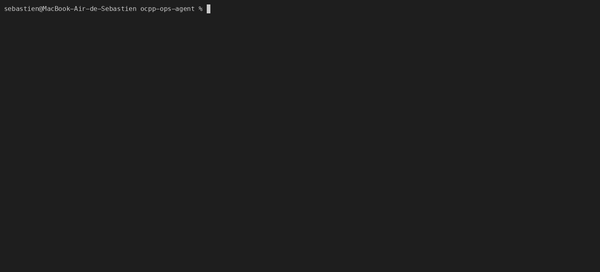

# OCPP Operations Agent

An open-source simulator of an OCPP 1.6J charging-station fleet that injects realistic faults, plus an AI agent that diagnoses, verifies and fixes them under guardrails. The agent is benchmarked against a rule-based script on the same reproducible scenarios, to measure where it helps and where it doesn't.

**Status:** work in progress. See [ROADMAP.md](ROADMAP.md) for the plan and current progress.



*`make demo`: 50 virtual OCPP 1.6J chargers connect to the embedded CSMS and boot.*

## Quick start

Requires Python 3.11+.

```bash
python3 -m venv .venv
source .venv/bin/activate
pip install -e ".[dev]"
make test          # or: pytest -m "not slow" to skip the real-time scale test
make lint
make demo          # embedded CSMS + the 50 chargers of fleet.yaml, live status grid (Ctrl+C to stop)
```

The live grid shows one cell per charger with a colored dot per connector (green Available, blue in use, yellow Unavailable, red Faulted, gray offline), and an Attention list of chargers that are offline, not booted, Faulted or late on heartbeats. It fits a 100×30 terminal and follows window resizes; set `NO_COLOR=1` for letters instead of colors. `make demo` logs every OCPP message to `logs/csms-<time>.jsonl`. To connect the fleet to another CSMS instead: `python -m ocpp_ops.fleet --fleet fleet.yaml --csms-url ws://host:port/path`.

## Interoperability

The fleet also runs against [SteVe](https://github.com/steve-community/steve), an independent OCPP 1.6J CSMS: boot, status, heartbeats, GetConfiguration, ChangeConfiguration and Reset work with no protocol error. Details, results and how to reproduce: [docs/interop/steve.md](docs/interop/steve.md).

## Data and IP

This project uses no TotalEnergies data, configuration or code. Simulated faults are derived from the OCPP 1.6 specification and general knowledge of charging-network operations.

## License

[MIT](LICENSE)
