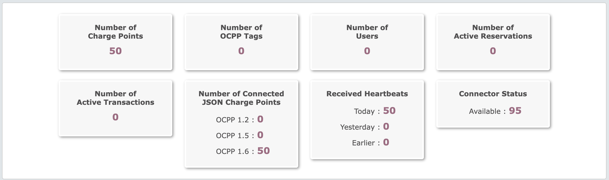
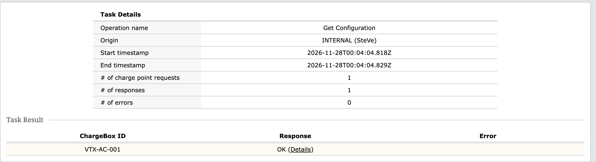
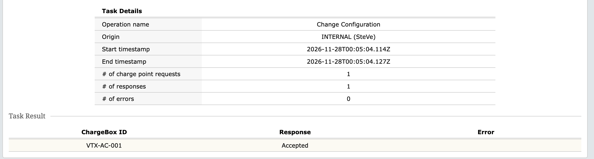
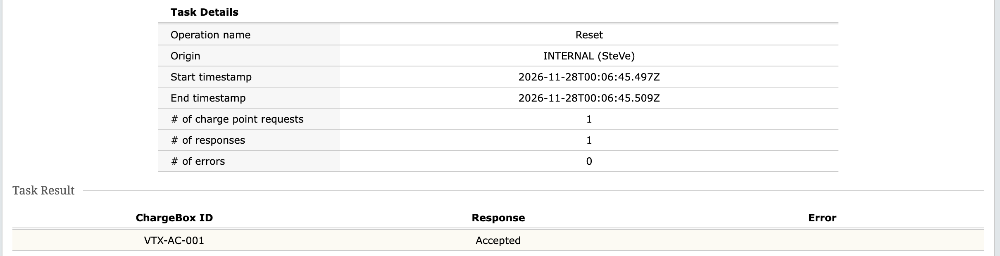
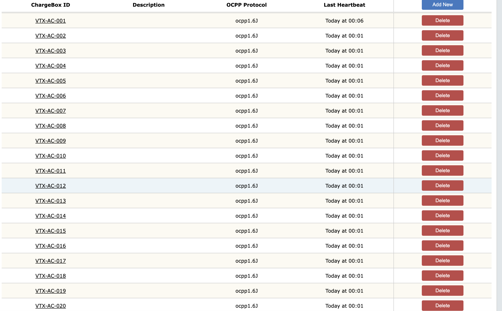

# Interoperability: SteVe

This page records how our virtual fleet behaves against [SteVe](https://github.com/steve-community/steve), an independent open-source OCPP Central System (Java, GPL). We did not copy anything from SteVe into this repository: no code, no configuration, no compose file. SteVe ran on its own, next to the repo, and the fleet connected to it as a third-party CSMS.

**Summary:** boot, StatusNotification for connectors 0..N, Heartbeat, and three commands sent from SteVe's UI (GetConfiguration, ChangeConfiguration, Reset) all work, with no CALLERROR on either side. We found one behavior worth knowing about on SteVe's side (it queries the configuration before it answers the boot) and no deviation on ours.



*SteVe's dashboard during the 50-charger run: 50 charge points connected over OCPP 1.6, and 95 connectors Available, which is every connector of `fleet.yaml` (25 × 2 + 15 × 1 + 10 × 3). "Received Heartbeats: 50" counts charge points whose "Last Heartbeat" is today, not Heartbeat messages: only one charger sent Heartbeats in this run (see [Heartbeat cadence](#heartbeat-cadence)).*

## Setup tested

| | |
|---|---|
| Date | 2026-11-27 |
| SteVe | 3.16.0-SNAPSHOT, commit `d5a5d1e6` (`git describe`: `steve-3.15.0-11-gd5a5d1e6`), built and run locally with SteVe's own docker compose setup |
| SteVe runtime | OpenJDK 25.0.5.1, MariaDB 10.11.16, Docker Desktop |
| SteVe settings | defaults; heartbeat interval 240 min (sent as 14400 s) |
| Our side | this repo, `fleet.yaml` (50 chargers, 3 templates with 1, 2 and 3 connectors), external mode (`--csms-url`) |
| Machine | Apple M5, 24 GB, macOS 26.6, Python 3.13.3, ocpp 2.1.0, websockets 17.4. Fleet and SteVe on the same machine |
| Protocol | OCPP 1.6J over plain `ws://`, no security profile |

## How to reproduce

1. **Run SteVe** by following its own README (it ships a docker compose setup). By default, its web UI is at `http://localhost:8180/steve/manager/home` and its OCPP-J endpoint at `ws://localhost:8180/steve/websocket/CentralSystemService/<chargeBoxId>`.
2. **Register the charger ids.** SteVe only accepts chargers it knows. Print our 50 ids:
   ```bash
   python -c "from pathlib import Path; from ocpp_ops.fleet.config import load_fleet; print('\n'.join(c.id for c in load_fleet(Path('fleet.yaml')).chargers()))"
   ```
   Paste them into SteVe's "Add Charge Point" page (list mode). Each one must have registration status *Accepted*.
3. **Run the fleet against SteVe** (the base URL, without the charger id: we append it):
   ```bash
   python -m ocpp_ops.fleet --fleet fleet.yaml --csms-url ws://localhost:8180/steve/websocket/CentralSystemService
   ```
   In this mode the live grid shows the charger side, and every frame goes to `logs/fleet-<time>.jsonl`.
4. **Run the optional interop tests** (skipped unless `STEVE_URL` is set; CI never sets it):
   ```bash
   STEVE_URL=ws://localhost:8180/steve/websocket/CentralSystemService pytest -m interop -s
   ```
   They boot one charger per template, then all 50 at once. They check for no CALLERROR, an accepted boot, an answer for every StatusNotification, and that the interval sent by SteVe became the charger's HeartbeatInterval. They also print the boot time of the 50.
5. **Commands from SteVe's UI.** From SteVe's operations pages, send to one charger, in this order: GetConfiguration (all keys), ChangeConfiguration `HeartbeatInterval=10`, wait ~30 s, Reset (Soft). The order matters: a Reset makes the charger boot again, and SteVe then re-imposes its own interval.

## What was tested and results

All results are read from our charger-side JSONL log, and cross-checked in SteVe's UI where it shows the same information.

| Area | Test | Result |
|---|---|---|
| Connection | URL = base path + `/<chargeBoxId>`, subprotocol `ocpp1.6` | Pass. SteVe lists the chargers as `ocpp1.6J` |
| Boot | BootNotification, 3 templates, then 50 chargers | Pass. `Accepted`, interval 14400 s, adopted as HeartbeatInterval |
| Status | StatusNotification for connectors 0..N after boot | Pass. Every one answered. SteVe's connector status page shows connectors 1..N as Available / NoError (connector 0 is answered but not shown on that page) |
| Heartbeat | Cadence at the configured interval | Pass. After `HeartbeatInterval=10`: first heartbeat 10.0 s after the change, then 10.01 s apart (10 heartbeats, all answered). SteVe's 14400 s interval itself was not observed (4 hours) |
| GetConfiguration | Sent by SteVe with `"key": []` | Pass. An empty list is answered with all keys (OCPP 1.6 §5.8) |
| ChangeConfiguration | `HeartbeatInterval=10` from SteVe's UI | Pass. `Accepted`, applied at once. SteVe follows it with its own GetConfiguration, which reports 10 |
| Reset | `Soft` from SteVe's UI | Pass. `Accepted` is sent before the connection closes (close code 1000); reconnect and boot 5.0 s later (`reboot_delay`); statuses sent again; HeartbeatInterval back to SteVe's 14400 s |
| Errors | CALLERROR or unparseable frame in either direction | None, over all runs |
| Shutdown | Ctrl+C on the fleet | Clean exit; SteVe marks the chargers disconnected |

### Commands from SteVe's UI

The three commands were sent to VTX-AC-001 from SteVe's operations pages while all 50 chargers were connected. SteVe's task results agree with our charger-side log: each CALL reached the charger, and was answered, within SteVe's own task window. Both clocks are on the same machine.

| Command | SteVe task (UTC) | Charger log: CALL received → answer sent | Answer |
|---|---|---|---|
| GetConfiguration (all keys) | 00:04:04.818 → .829 | .822 → .824 | all keys, `HeartbeatInterval = 14400` |
| ChangeConfiguration `HeartbeatInterval=10` | 00:05:04.114 → .127 | .120 → .123 | `Accepted` |
| Reset `Soft` | 00:06:45.497 → .509 | .503 → .505 | `Accepted` |







*SteVe's task results for the three commands: OK / Accepted / Accepted, one response each, no error. SteVe also sent GetConfiguration on its own, at each boot and right after the ChangeConfiguration (00:05:04.130, after the task ended). Those don't appear as tasks here; our log shows them all answered.*

### Heartbeat cadence

After the ChangeConfiguration, VTX-AC-001 sent 10 Heartbeats: the first 10.0 s after the change, then every 10.01 s, the last at 00:06:44, just before the Reset. After the Reset it booted again at 00:06:50, SteVe re-imposed 14400 s, and it sent no more Heartbeats in the remaining 63 s of the run. The 49 other chargers kept SteVe's 14400 s (4 hours) from their boot at 00:01, so they sent **no Heartbeat at all** during the ~6-minute run.



*SteVe's charge point list, first 20 of 50 rows. VTX-AC-001 shows 00:06: its last Heartbeat (00:06:44) and its reboot (00:06:50) both fall in that minute. The others show 00:01, the minute they booted, even though they never sent a Heartbeat: SteVe updates this column on other messages too (see below).*

## Behaviors and deviations found

**SteVe sends GetConfiguration before it answers BootNotification.** After every boot, SteVe sends `GetConfiguration` (all keys) while our BootNotification is still unanswered, and only then sends `BootNotification.conf`. Our charger answers with the values it holds at that moment, which is correct: OCPP-J allows one outstanding CALL per direction, so answering the CSMS while our own CALL waits is expected. The consequence is on SteVe's side. The `HeartbeatInterval` it stores is the value from *before* the boot answer, which then changes it. After a fresh start SteVe stored 60 while the charger used 14400; after the Reset it stored 10 while the charger was back on 14400. SteVe's stored configuration stays stale until the next GetConfiguration.

Is it a spec deviation? OCPP 1.6 §4.2 explicitly allows the Central System to send requests while a boot is *Pending*, and forbids them after *Rejected*. We did not find a rule for requests sent before any answer at all. We record it as a gray area, to check against the spec PDF, not as a SteVe bug.

**SteVe's "Last Heartbeat" is not only about Heartbeat messages.** In the 50-charger run, 49 chargers sent no Heartbeat at all, yet SteVe shows a "Last Heartbeat" at the minute they booted ([charge point list](#heartbeat-cadence)). Its dashboard counts them as "Received Heartbeats: 50". SteVe updates this time on other messages too, so it works as a "last seen" time. This is a UI observation, not a protocol issue. But an operator, or our agent in week 3, reading "last heartbeat" from SteVe must know it doesn't prove a Heartbeat was sent.

**Our side:** no deviation found. Two things to know:
- Our charger does not use `currentTime` from SteVe's answers: there is no clock sync. Week 2 adds a clock-drift fault, which will make this matter.
- On Reset our charger closes the connection with 1000 (normal closure), after the `Accepted` answer has been sent.

## Measured boot time

**50 chargers booted against SteVe in 0.182 s** (median of 5 runs, range 0.152–0.252 s; the first run was the slowest). "Booted" means the boot is accepted and every StatusNotification (connectors 0..N) is answered. It is read from the charger-side log, which is polled every 20 ms, so the precision is about ±0.02 s.

Context, needed to read the number correctly:
- single fleet process, jitter 0 (all 50 connect at once, the worst case for the CSMS)
- SteVe in Docker Desktop with MariaDB, **on the same machine** as the fleet (localhost, no real network)
- same machine as above, SteVe at commit `d5a5d1e6`, default settings
- for comparison, the same fleet against our embedded CSMS (in-memory, same process) boots in 0.060 s. SteVe persists every message to its database and sends a GetConfiguration to each charger at boot

This is a simulator-and-CSMS throughput number on one machine, not a field number.

## Not tested

- Transactions (Authorize, StartTransaction, StopTransaction, MeterValues during a session): not implemented on our side yet (week 2)
- Boot Pending / Rejected, and unknown charger ids
- Other SteVe commands (ChangeAvailability, TriggerMessage, UnlockConnector, ...)
- Security profiles, TLS, basic auth
- Long runs (hours) and SteVe's own 4-hour heartbeat interval
